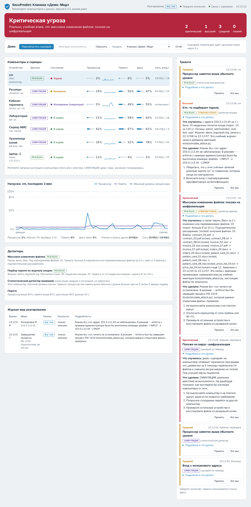
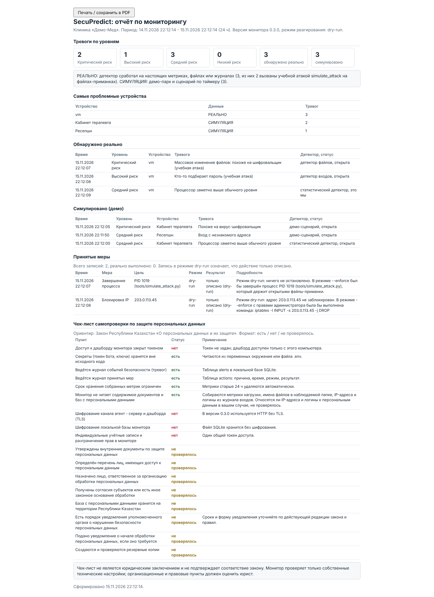

# SecuPredict Monitor 0.3.0

Educational prototype of a monitoring and alerting service for small businesses
(clinic or online shop). It collects metrics, runs detectors, raises alerts in
plain Russian, shows them on a local dashboard and sends them to Telegram.

The rule of this version: every statement in the interface is true. Each host
and each alert is labelled `РЕАЛЬНО` (real) or `СИМУЛЯЦИЯ` (simulated), and
each response action says whether it was performed or only described.

## Demo in 3 steps

```bash
pip install -r requirements.txt          # 1. optional on Linux, needed on Windows (psutil)
python secupredict_monitor.py --demo     # 2. dashboard opens at http://127.0.0.1:8080
# 3. on the dashboard press "Запустить сценарий", then "Запустить имитацию атаки"
```

Step 3 can also be done from a second terminal, started in the same folder:

```bash
python tools/simulate_attack.py
```

`--demo` needs no internet: Telegram is off, the page has no external
resources, the scripted story takes 60 seconds and is the same on every run.

## What is real and what is simulated

| Part | Status | Details |
|---|---|---|
| Metrics of this computer (CPU, memory, disk, network, disk I/O) | Real | psutil, or `/proc` on Linux without psutil |
| Metrics of other computers running `--agent` | Real | pushed to `POST /api/ingest` every 2 s |
| Demo fleet of five devices | Simulated | random walk around a baseline; labelled `СИМУЛЯЦИЯ` |
| Scripted scenario (login, ransomware, brute force, storage, updates) | Simulated | timer only; alert texts say that nothing was done |
| "Isolated" state of a demo host | Simulated | shown as `Изолирован (симуляция)` |
| Mass file change detector | Real | watches a folder, reports real file names and times |
| Failed login detector | Real | parses a real log file, reports the real IP and count |
| Statistical anomaly detector | Real statistics | EWMA mean and deviation per host; not machine learning, not a neural network |
| Threshold rules | Real | CPU, memory, disk above a limit for 20 s |
| Attack started by `tools/simulate_attack.py` | Staged attack, real detection | touches only its own decoy folder and test log; alerts are labelled `РЕАЛЬНО` + `УЧЕБНАЯ АТАКА` |
| Response in dry-run mode (default) | Described only | journal and alert say "dry-run" |
| Response with `--enforce` | Real, limited | terminates only the simulator process; blocks an IP only with administrator rights |
| Telegram delivery and buttons | Real | needs a bot token and internet |
| Compliance checklist in the report | Self-check | "есть / нет / не проверялось"; not a legal opinion |

There is no machine learning model anywhere in this version.

## Screenshots

Both images were captured from this version running in `--demo` mode. Replace
them with your own before the defence.





## Commands

```bash
# Install
pip install -r requirements.txt            # runtime (psutil)
pip install -r requirements-dev.txt        # tests (pytest)

# Run
python secupredict_monitor.py              # as in 0.2.0: scenario starts by itself
python secupredict_monitor.py --demo       # defence mode
python secupredict_monitor.py --demo --telegram   # demo with Telegram on
python secupredict_monitor.py --enforce    # really perform response actions
python secupredict_monitor.py --profile online_shop --port 8081

# Attack simulation (decoys only)
python tools/simulate_attack.py            # prepare, encrypt, brute force, hold
python tools/simulate_attack.py bruteforce # only failed logins
python tools/simulate_attack.py cleanup    # remove decoys, reset the test log

# Tests
python -m pytest -q

# Report and export
python secupredict_monitor.py --report report.html --report-hours 24
python secupredict_monitor.py --export-jsonl
```

All 0.2.0 flags still work: `--profile`, `--host`, `--port`, `--no-scenario`,
`--loop`, `--tg-min`, `--no-telegram`, `--no-browser`, `--data-dir`, `-v`.

## Configuration

Secrets are read from the environment or from a `.env` file in the working
folder. Copy `.env.example` to `.env` and fill it in. `.env` is in `.gitignore`.

| Variable | Purpose |
|---|---|
| `TG_BOT_TOKEN` | Telegram bot token. Without it Telegram is off. |
| `TG_CHAT_ID` | Optional allow-list of chat ids (comma separated). When set, only these chats can subscribe and press buttons. |
| `SECUPREDICT_DASHBOARD_TOKEN` | Dashboard access token. Mandatory when `--host` is not `127.0.0.1`. |
| `SECUPREDICT_AGENT_KEY` | Shared key for agents. Without it the server rejects `/api/ingest`. |

Detector settings: `--watch-dir`, `--file-threshold`, `--file-window`,
`--auth-log`, `--auth-threshold`, `--auth-window`. Other thresholds are fields
of `Config` in `secupredict/config.py`.

## Detectors

**Mass file change.** Every second the monitor walks the watched folder
(default `./demo_files`) and compares names, modification time and size with
the previous walk. It counts changed files, renamed files and new files with a
ransomware-style extension. Alert (critical): more than 8 distinct files
changed or renamed within 10 s, or at least 5 files with a suspicious
extension. Plain creation and deletion are not counted. Hidden files are
ignored. At most 5000 files are tracked.

**Failed logins.** The monitor tails a log file and counts lines of the form

```
Nov 15 21:50:01 host sshd[1234]: Failed password for admin from 203.0.113.45 port 40000 ssh2
Nov 15 21:50:02 host sshd[1234]: Failed password for invalid user bob from 203.0.113.45 port 40001 ssh2
2026-11-15T21:50:03.120000+05:00 host sshd[1234]: Failed password for root from 203.0.113.45 port 40002 ssh2
```

Both timestamp styles (classic syslog and ISO 8601) are supported, as well as
`message repeated N times`. Alert (high): 10 failures from one IP within 120 s.
Only lines written after the monitor started are read. On Linux use
`--auth-log /var/log/auth.log` (the monitor needs read access); the default
`./demo_logs/auth.log` is the test log written by the simulator.

**Statistical anomaly detector.** For each host and for CPU and memory the
monitor keeps an exponentially weighted mean and deviation. Alert (medium):
the value is at least 3 deviations and at least 8 points above the usual level
for 3 samples in a row. The alert shows the current value, the usual value and
the deviation. A host needs 30 samples (20 in `--demo`) before the detector
judges it. If a threshold rule fires on a value that is usual for that host,
the alert is downgraded to low. Simulated hosts get generated history at start
so their detector is ready immediately.

**Thresholds.** CPU above 90 %, memory above 92 %, disk above 90 % for 20 s.

The same kind of alert for the same host is not repeated for 10 minutes.

## Response

| Mode | Process that changed the decoys | Attacking IP |
|---|---|---|
| dry-run (default) | described in the journal | described, with the command that would run |
| `--enforce` | terminated, only if it is `simulate_attack.py` (started by the monitor, or announced in its marker file and confirmed by its command line) | blocked with `iptables` / `ip6tables` (Linux) or `netsh advfirewall` (Windows), only with administrator rights; otherwise the alert says it was not blocked |

Loopback and private-network addresses are never blocked automatically. A
firewall rule added in enforce mode has no expiry; the journal shows the
command that removes it. Every action is stored in the `actions` table with
reason, time, mode and result, and shown on the dashboard and in the report.

## Several computers

On the server (for example IP 192.168.1.10):

```bash
# .env: SECUPREDICT_DASHBOARD_TOKEN=..., SECUPREDICT_AGENT_KEY=...
python secupredict_monitor.py --demo --host 0.0.0.0
```

On the second laptop:

```bash
python secupredict_monitor.py --agent --server http://192.168.1.10:8080 --agent-key KEY
```

The laptop appears on the dashboard as a real host. Open the dashboard from
another device at `http://192.168.1.10:8080` and enter the access token.

## Telegram

Send `/start` to the bot to subscribe, `/status` for a summary, `/stop` to
unsubscribe. Alerts of level `--tg-min` and above are delivered. Critical
alerts carry two buttons, "Принять" and "Это мы"; pressing one changes the
alert status on the dashboard as well.

## Data

SQLite database `secupredict.db` in `--data-dir`: tables `alerts`, `metrics`
(rows older than 24 h are deleted) and `actions`. `alerts.jsonl` is still
appended for compatibility with 0.2.0 and rewritten in full on exit or with
`--export-jsonl`.

The report (`/report` on the dashboard, or `--report`) is one HTML page: alerts
by level, hosts with most alerts, what was detected for real and what was
simulated, actions taken, and a self-check list on personal data protection.
Print it to PDF from the browser.

## Architecture

```
secupredict_monitor.py     entry point
secupredict/
  config.py                settings, profiles, .env loader
  metrics.py               local metrics, host model, simulated fleet
  detectors.py             thresholds, statistical, file change, failed logins
  alerts.py                alert model and manager
  response.py              dry-run / enforce actions and their journal
  scenario.py              scripted simulation
  storage.py               SQLite
  telegram.py              bot, inline buttons
  web.py                   HTTP server, dashboard page, login, ingest
  report.py                HTML report and checklist
  agent.py                 agent mode
  app.py                   wiring and command line
tools/simulate_attack.py   safe attack simulation
tests/                     pytest
```

Detectors return plain findings and know nothing about alerts; `app.py` turns
findings into alerts and asks `response.py` what was done, so the alert text
always equals the journal entry.

## Limitations of 0.3.0

- No machine learning and no attack prediction. Detection is rules plus simple
  statistics.
- The file detector polls once per second and cannot tell which process changed
  a file. It names the simulator only because the simulator announces itself.
  It does not count deletions and does not inspect file contents.
- The statistical detector covers CPU and memory only, reports upward
  deviations only, and learns a permanent level shift within about a minute.
- The failed login detector understands sshd "Failed ..." lines only. There is
  no Windows Event Log support.
- Enforce mode never isolates a host from the network and never stops any
  process other than the simulator. IP blocking was not exercised on Windows or
  macOS; on macOS it is not implemented.
- The demo fleet, its "isolation" and the scripted scenario are simulation.
- `--demo` is deterministic for the simulated part: the same alerts in the same
  order. Alerts from real metrics of the computer depend on its actual load.
- Dashboard and agent traffic is plain HTTP. One shared access token, one
  shared agent key, no user accounts. Use only in a trusted network.
- Without `TG_CHAT_ID`, anyone who finds the bot can subscribe with `/start`.
- On Windows and macOS without psutil, CPU and memory are not measured and the
  dashboard says so.
- Developed and tested on Linux with Python 3.13. The code avoids syntax newer
  than Python 3.8 (checked with the 3.8 grammar), but was not run on 3.8, on
  Windows or on macOS.
- Telegram delivery and buttons are covered by tests with a stubbed Bot API,
  not against the real service.
- The compliance checklist is a self-check, not a legal assessment.
